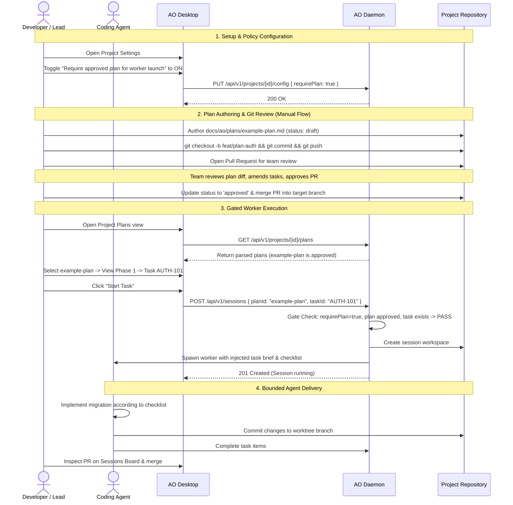

# Agent Orchestrator (AO) Company MVP Specification

This document specifies the architecture, data contracts, security invariants, user journeys, UI design, and testing matrix for the **AO Company MVP**. It builds on current Agent Orchestrator foundations and outlines the roadmap for multi-agent autonomous engineering organization workflows.

---

## 1. Current AO Architecture and Context

### 1.1 Architecture Overview

Agent Orchestrator is desktop software for supervising parallel AI coding-agent sessions. Its current architecture is documented in [architecture.md](architecture.md) and [STATUS.md](STATUS.md):

- **Loopback HTTP Daemon:** The backend daemon binds loopback unauthenticated and serves REST APIs, Server-Sent Events (SSE) at `GET /api/v1/events` backed by Change Data Capture (CDC), and WebSocket terminal multiplexing (`/mux`). An opt-in, authenticated LAN listener serves mobile companion traffic behind bearer authentication ([docs/adr/0001-lan-listener-for-mobile.md](adr/0001-lan-listener-for-mobile.md)), while administrative control routes (`/shutdown`, telemetry, mobile control) remain strictly loopback-gated.
- **Persistence & CDC:** Durable state is persisted in SQLite using goose migrations and sqlc-generated query models. SQLite triggers append mutations to `change_log`, which an in-process CDC poller tails and broadcasts over SSE with `Last-Event-ID` resume capability.
- **Durable Minimalism vs. Derived Status:** The core architectural mental model follows:
  $$\text{Observe External Facts} \longrightarrow \text{Update Durable Facts} \longrightarrow \text{Derive Display Status at Read Time}$$
  Display statuses (such as `working`, `needs_input`, `ci_failed`, `mergeable`, `in_review`) are **never stored** in SQLite. They are computed dynamically at read time by `service.Session` from immutable durable facts: `activity_state`, `is_terminated`, runtime probe outcomes, and SCM facts (`pr`, `pr_checks`, `pr_comments`).
- **Workspace Isolation:** Project sessions run inside dedicated Git worktrees managed through the workspace adapter ([architecture.md](architecture.md)). Projectless standalone workers run inside AO-managed plain directories.
- **Interface Modes & Handoff:** Sessions run in either **TUI mode** (native PTY / ConPTY host, tmux fallback) or **Chat mode** (native ACP or provider drivers). Certain providers run in detached per-session hosts as documented in [STATUS.md](STATUS.md). Compatible sessions can transition between TUI and Chat through a capability-gated handoff protocol without losing session or Git worktree identity.
- **Observation Loops:** The SCM observer periodically polls GitHub/GitLab for PR status, CI checks, and review comments, feeding facts to the lifecycle manager to trigger agent nudges. The runtime reaper periodically probes runtime liveness; failed probes report observation facts rather than declaring premature process death.
- **Frontend Supervisor:** The frontend is an Electron application with React 19, TanStack Router/Query, Tailwind CSS, and custom shadcn primitives. It communicates with the daemon exclusively over HTTP/SSE via a typed OpenAPI client (`frontend/src/api/schema.ts`).
- **State Confinement:** All application state, daemon runtime files, SQLite databases, and Electron `userData` live strictly within `~/.ao` (overridable via `AO_DATA_DIR`).

### 1.2 The Problem: Lack of Structured Organizational Planning

Current AO excels at supervising individual, ad-hoc agent sessions. However, coordinating multiple agents toward a larger organizational goal exposes limitations:

1. **Ad-Hoc Spawning:** Workers are spawned from informal prompts or orchestrator conversations. There is no repository-tracked record of what tasks belong to which milestone.
2. **Context Drift:** Coding agents easily wander beyond intended scope without strict task boundaries and granular acceptance criteria.
3. **No Verifiable Review Gate:** There is no mechanism to verify that an agent's work satisfies a formal plan before merging or moving to the next task.
4. **Proprietary Plan Lock-in vs. Code Truth:** External issue trackers create dual-source drift between issue state and repository code.

---

## 2. AO Company MVP Vision

The **AO Company MVP** establishes Agent Orchestrator as a structured multi-agent engineering coordination engine. It introduces version-controlled planning and gated task execution directly within project repositories.

### 2.1 Core Architectural Principles

1. **Git is the Single Source of Truth:** Plans are Markdown files with YAML frontmatter stored in the repository at `docs/ao/plans/*.md`. Plans are branched, committed, diffed, and reviewed through normal Git pull requests.
2. **Approved Plan Phases & Granular Checklists:** Work is grouped into numbered phases (`## Phase N: Title`) and discrete tasks (`### TASK-ID: Title`). Each task contains verifiable checklist items (`- [ ]`).
3. **Opt-In Project Gate (`requirePlan`):** Projects can enforce plan compliance via an opt-in project configuration flag (`requirePlan`, defaulting to `false`). When enabled, worker sessions cannot be spawned unless bound to an approved plan and an uncompleted task.
4. **Plan-Bound Worker Launch:** When a worker is launched for a plan task, AO injects task objectives, boundaries, and checklist criteria directly into the agent's briefing, keeping the agent tightly bounded.
5. **Read-Only Plans API & Manual Publication:** The daemon provides a read-only query API for parsed plans. In the MVP, plans are authored in the workspace or editor and published through standard Git workflows (local commit, user push, pull request). Automatic remote Git pushing or cloud upload is **not** implemented in the MVP.
6. **Decoupled Future Extensions:** Global Skills, multi-agent management hierarchies, and Graphify knowledge graphs are explicitly designed as later phases. In particular, Graphify is a derived index, **never** the plan source of truth.

---

## 3. Plan Schema Specification

Plans are stored as Markdown documents in `docs/ao/plans/*.md` relative to the repository root.

### 3.1 YAML Frontmatter

Every plan file must begin with a YAML frontmatter block:

```yaml
---
id: example-plan
title: Authentication Engine Overhaul
status: approved
---
```

#### Frontmatter Fields

| Field | Type | Requirement | Description |
|---|---|---|---|
| `id` | `string` | **Required** | Unique plan identifier. Must match `^[a-z0-9][a-z0-9-]*[a-z0-9]$` (3–64 characters). Must match the file basename without `.md` (e.g. `id: example-plan` in `docs/ao/plans/example-plan.md`). |
| `title` | `string` | **Required** | Human-readable title (1–120 characters). |
| `status` | `string` | **Required** | Plan lifecycle status: exactly `draft` or `approved`. |
| `version` | `integer` | *Optional* | Schema version. Defaults to `1`. |
| `created_at` | `string` | *Optional* | ISO-8601 date string (`YYYY-MM-DD`). |
| `updated_at` | `string` | *Optional* | ISO-8601 date string (`YYYY-MM-DD`). |

### 3.2 Markdown Body Structure

Following the frontmatter, the document contains:

1. **Context & Overview (*Optional*):** Markdown prose introducing plan goals and background.
2. **Phases (**Required**):** Headings matching the regex:
   ```regex
   ^## Phase ([0-9]+):\s*(.+)$
   ```
   - Phase numbers must be positive integers ($1, 2, 3, \dots$).
   - Phase numbers should be monotonically increasing.
3. **Tasks (**Required**):** Headings matching the regex:
   ```regex
   ^### ([A-Z0-9_-]+):\s*(.+)$
   ```
   - `TASK-ID` must be uppercase alphanumeric with hyphens or underscores (e.g., `AUTH-101`, `DB-02`).
   - `TASK-ID` must be unique across the entire plan.
4. **Checklists (**Required**):** Each task must contain at least one checklist item:
   ```markdown
   - [ ] Unfinished checklist item
   - [x] Completed checklist item
   ```
   A task without at least one `- [ ]` or `- [x]` item is a schema validation error.

### 3.3 Reference Example

See [example-plan.md](ao/plans/example-plan.md) for a complete, fully conforming plan file.

---

## 4. Execution Gate & Worker Launch Contract

### 4.1 Project Configuration: `requirePlan`

The project configuration model `domain.ProjectConfig` (`backend/internal/domain/projectconfig.go`) is extended with an opt-in boolean flag:

```go
type ProjectConfig struct {
    // ... existing fields ...
    RequirePlan bool `json:"requirePlan,omitempty"`
}
```

- **Default Value:** `false`. Existing projects and workflows are completely unaffected.
- **Opt-In:** When set to `true` via `PUT /api/v1/projects/{id}/config` or project settings in the UI, all worker spawns for this project are gated.

### 4.2 Proposed Storage Migration

To record plan and task bindings for sessions, a new SQLite migration is proposed:

```sql
-- Migration: Add plan binding columns to sessions
ALTER TABLE sessions ADD COLUMN plan_id TEXT NOT NULL DEFAULT '';
ALTER TABLE sessions ADD COLUMN task_id TEXT NOT NULL DEFAULT '';
CREATE INDEX idx_sessions_plan_task ON sessions (plan_id, task_id);
```

### 4.3 Spawn Enforcement Gate

When `SessionManager.Spawn()` is invoked with `ports.SpawnConfig` (`backend/internal/ports/session.go`):

```mermaid
flowchart TD
    Start([Spawn Request]) --> CheckProject{Project attached?}
    CheckProject -->|No, Standalone| AllowSpawn[Bypass Plan Gate]
    CheckProject -->|Yes| CheckConfig{Project requirePlan == true?}
    CheckConfig -->|No| AllowSpawn
    CheckConfig -->|Yes| ValidateBinding{PlanID and TaskID provided?}
    ValidateBinding -->|No| RejectMissing[Reject: PLAN_REQUIRED]
    ValidateBinding -->|Yes| LoadPlan[Load Plan from docs/ao/plans/plan-id.md]
    LoadPlan --> CheckExist{Plan file exists?}
    CheckExist -->|No| RejectNotFound[Reject: PLAN_NOT_FOUND]
    CheckExist -->|Yes| ParsePlan[Parse YAML Frontmatter & Structure]
    ParsePlan --> CheckValid{Valid Schema?}
    CheckValid -->|No| RejectMalformed[Reject: INVALID_PLAN_SCHEMA]
    CheckValid -->|Yes| CheckApproved{status == 'approved'?}
    CheckApproved -->|No| RejectDraft[Reject: PLAN_NOT_APPROVED]
    CheckApproved -->|Yes| FindTask{TaskID exists in plan?}
    FindTask -->|No| RejectTaskNotFound[Reject: TASK_NOT_FOUND]
    FindTask -->|Yes| CheckCompleted{Task checklist all [x]?}
    CheckCompleted -->|Yes & No Override| RejectCompleted[Reject: TASK_ALREADY_COMPLETED]
    CheckCompleted -->|No| Proceed[Inject Task Briefing & Spawn Worker]
    Proceed --> AllowSpawn
```

### 4.4 Plan-Bound Worker Context Injection

When a worker session is successfully bound to a plan task:

1. **Prompt Augmentation:** The initial prompt preamble is automatically constructed:
   ```text
   # Bound Plan Task Briefing
   Plan: Authentication Engine Overhaul (ID: example-plan)
   Phase: Phase 1: Core Models and Storage
   Task: AUTH-101: Create User Sessions Table Migration

   ## Objective
   Create the SQLite goose migration for user sessions.

   ## Required Checklist
   - [ ] Create goose migration in backend/internal/storage/sqlite/migrations/
   - [ ] Run npm run sqlc to regenerate query models
   - [ ] Write table-driven unit tests for session queries

   ## Operational Rules
   - Focus exclusively on the checklist items for task AUTH-101.
   - Do not make changes outside the scope of this task.
   - Once all checklist items are satisfied, verify tests pass and prepare your report.
   ```
2. **Durable Attribution:** `plan_id` and `task_id` are stored directly on the session record via the proposed migration columns.
3. **Session Read Model:** `SessionResponse` DTO exposes `planId`, `taskId`, and `planTitle` so the frontend and CLI can display the task association.

---

## 5. Security & Path Safety Invariants

Reading plan files directly from project repositories requires strict confinement to prevent directory traversal and symlink escapes:

### 5.1 Plan ID Validation

Plan IDs are restricted to lowercase alphanumeric slugs:
```regex
^[a-z0-9][a-z0-9-]*[a-z0-9]$
```
Length must be between 3 and 64 characters. Any ID containing `.`, `/`, `\`, null bytes, or spaces is rejected immediately before any filesystem call.

### 5.2 Path Confinement Algorithm

All plan reads must execute through a validation helper:

```go
func ValidatePlanPath(projectRoot, planID string) (string, error) {
    if !validPlanIDRegex.MatchString(planID) {
        return "", apierr.Invalid("INVALID_PLAN_ID", "Plan ID contains invalid characters", nil)
    }

    cleanRoot := filepath.Clean(projectRoot)
    plansDir := filepath.Join(cleanRoot, "docs", "ao", "plans")
    targetPath := filepath.Join(plansDir, planID+".md")

    rel, err := filepath.Rel(plansDir, targetPath)
    if err != nil || strings.HasPrefix(rel, "..") || rel == "." {
        return "", apierr.Invalid("PATH_TRAVERSAL_DETECTED", "Plan path escapes plans directory", nil)
    }

    if info, err := os.Lstat(targetPath); err == nil {
        evalTarget, err := filepath.EvalSymlinks(targetPath)
        if err != nil {
            return "", apierr.InternalCause("SYMLINK_EVAL_FAILED", "Unable to resolve plan symlink", err)
        }
        relToRoot, err := filepath.Rel(cleanRoot, evalTarget)
        if err != nil || strings.HasPrefix(relToRoot, "..") {
            return "", apierr.Invalid("SYMLINK_ESCAPE_DETECTED", "Plan symlink resolves outside repository root", nil)
        }
    }

    return targetPath, nil
}
```

### 5.3 Renderer Markdown Sanitization

When plan content is rendered in Electron:
- Raw HTML is sanitized via DOMPurify.
- Embedded `<script>`, `<iframe>`, `<object>`, and `form` elements are stripped.
- Link URLs are restricted to `file://`, `http://`, and `https://`. External web links open in the user's default browser.

---

## 6. Technical, API, and Data Contracts

### 6.1 Data Transfer Objects (Proposed)

The daemon API proposes these read-only wire types in `backend/internal/httpd/controllers/dto.go`:

```go
// PlanSummaryResponse summarizes a plan for list views.
type PlanSummaryResponse struct {
    ID          string    `json:"id"`
    Title       string    `json:"title"`
    Status      string    `json:"status" enum:"draft,approved"`
    Version     int       `json:"version,omitempty"`
    Path        string    `json:"path"`
    PhaseCount  int       `json:"phaseCount"`
    TaskCount   int       `json:"taskCount"`
    DoneCount   int       `json:"doneCount"`
    CreatedAt   time.Time `json:"createdAt,omitempty"`
    UpdatedAt   time.Time `json:"updatedAt,omitempty"`
}

// PlanDetailResponse provides full parsed plan hierarchy.
type PlanDetailResponse struct {
    ID          string          `json:"id"`
    Title       string          `json:"title"`
    Status      string          `json:"status" enum:"draft,approved"`
    Version     int             `json:"version,omitempty"`
    Path        string          `json:"path"`
    Context     string          `json:"context,omitempty"`
    Phases      []PhaseResponse `json:"phases"`
    RawMarkdown string          `json:"rawMarkdown"`
    UpdatedAt   time.Time       `json:"updatedAt,omitempty"`
}

// PhaseResponse represents one phase grouping.
type PhaseResponse struct {
    Number int            `json:"number"`
    Title  string         `json:"title"`
    Tasks  []TaskResponse `json:"tasks"`
}

// TaskResponse represents one task in a plan.
type TaskResponse struct {
    ID          string                 `json:"id"`
    Title       string                 `json:"title"`
    Completed   bool                   `json:"completed"`
    Checklist   []ChecklistItemResponse `json:"checklist"`
    Description string                 `json:"description,omitempty"`
}

// ChecklistItemResponse is one item in a task's checklist.
type ChecklistItemResponse struct {
    Text      string `json:"text"`
    Completed bool   `json:"completed"`
    Line      int    `json:"line"`
}

// ListPlansResponse wraps list results.
type ListPlansResponse struct {
    Plans []PlanSummaryResponse `json:"plans"`
}
```

### 6.2 Proposed Read-Only REST Endpoints

The proposed read-only endpoints mount under `/api/v1/projects/{id}/plans`:

| Method | Path | Description | Status Codes |
|---|---|---|---|
| `GET` | `/api/v1/projects/{id}/plans` | List all valid plans found in `docs/ao/plans/`. | 200, 404, 500 |
| `GET` | `/api/v1/projects/{id}/plans/{planId}` | Retrieve parsed plan and task hierarchy. | 200, 400, 404, 500 |

*Note:* Authoring and modifying plan files in the MVP occurs directly in the repository via standard files, editors, and Git workflows. Dedicated daemon write endpoints (`POST /plans`, `PUT /plans`) are omitted from the MVP.

### 6.3 Spawn Endpoint Extension

`ports.SpawnConfig` (`backend/internal/ports/session.go`) and `SpawnSessionRequest` (`backend/internal/httpd/controllers/dto.go`) are extended:

```go
type SpawnSessionRequest struct {
    // ... existing fields ...
    PlanID string `json:"planId,omitempty" maxLength:"64"`
    TaskID string `json:"taskId,omitempty" maxLength:"64"`
}
```

### 6.4 Structured Error Vocabulary

Following `backend/internal/httpd/apierr/apierr.go`, all plan errors use classified error envelopes:

```json
{
  "error": {
    "code": "PLAN_GATE_BLOCKED",
    "message": "Project requires an approved plan and task for worker launch.",
    "details": {
      "projectId": "proj_core",
      "requirePlan": true,
      "planId": "example-plan",
      "reason": "Plan status is 'draft', but 'approved' is required."
    }
  },
  "requestId": "req_01h8abc..."
}
```

| Code | HTTP Status | Kind | Trigger Condition |
|---|---|---|---|
| `PLAN_REQUIRED` | 422 | `KindInvalid` | Project has `requirePlan: true`, but `planId` or `taskId` was omitted. |
| `PLAN_NOT_FOUND` | 404 | `KindNotFound` | The requested `planId` does not exist in `docs/ao/plans/`. |
| `PLAN_NOT_APPROVED` | 422 | `KindInvalid` | The plan exists but its frontmatter `status` is `draft`. |
| `TASK_NOT_FOUND` | 404 | `KindNotFound` | The specified `taskId` does not exist within the plan. |
| `TASK_ALREADY_COMPLETED` | 422 | `KindInvalid` | All checklist items in the task are already checked `[x]`. |
| `INVALID_PLAN_SCHEMA` | 400 | `KindInvalid` | Markdown or YAML frontmatter parsing failed. |
| `PATH_TRAVERSAL_DETECTED` | 400 | `KindInvalid` | Plan ID or path contains illegal navigation characters. |

---

## 7. User Journey



---

## 8. UI & Design System Alignment

All proposed UI additions strictly follow [DESIGN.md](../DESIGN.md):
- **Visual Identity:** Dark-first precision instrument. Layered charcoal surfaces (`--color-bg-primary`, `--color-bg-secondary`), modest border radii (`--radius-md`), minimal 1px boundaries (`--color-border`), and zero gratuitous cards-inside-cards.
- **Typography:** Sentence case everywhere. Mono font (`--font-family-mono`) only for code-like values: plan IDs, task IDs, branches, and tabular numbers.
- **Interaction Contract:** All actions use the shared `Button` primitive with appropriate variants (`primary`, `accent`, `secondary`, `ghost`). Ghost buttons use the sidebar's growing hover pill. Absolutely **no tap scale or press motion**.
- **Shared List Rule:** Lists of peer objects (plans, tasks) use a single composed container with hairline dividers, not separately outlined cards.

### 8.1 Project Route Integration

In the frontend router ([`frontend/src/renderer/routes/`](../frontend/src/renderer/routes/)), project views are routed under `_shell.projects.$projectId.tsx`. A dedicated plans route is proposed:

```text
frontend/src/renderer/routes/_shell.projects.$projectId_.plans.tsx
```

Access to this route is provided via a navigation control in `ProjectBoardActions.tsx`.

#### Plans List Surface

```
---------------------------------------------------------------------------------------------------------
  STATUS     ID              TITLE                                  TASKS    UPDATED        ACTIONS
---------------------------------------------------------------------------------------------------------
  ● Approved example-plan    Authentication Engine Overhaul         4/6      2026-11-05     [ Open ]
  ○ Draft    plan-db-shards  Database Sharding and Replication      0/8      2026-11-04     [ Open ]
---------------------------------------------------------------------------------------------------------
```

- **Row Styling:** 32px height, shared list container, hairline divider (`--color-border`). No individual card outlines around rows.
- **Status Treatment:**
  - `approved`: Status glyph dot colored with `--color-status-ready`, text label "Approved".
  - `draft`: Status glyph dot colored with `--color-status-in-review`, text label "Draft".
- **Plan ID:** Rendered in monospace (`text-xs font-mono text-muted`).
- **Title:** Primary readable text (`text-sm font-medium`).
- **Task Ratio:** Tabular figures (`text-xs font-mono text-muted`), e.g., `4/6 tasks`.
- **Keyboard Navigation:** Arrow key navigation with visible semantic focus ring (`--color-focus-ring`).

### 8.2 Plan Detail Surface

Clicking a plan row opens the Plan Detail view:

```
+-------------------------------------------------------------------------------------------------------+
|  <- Back to Plans    example-plan                                                  [ Approved ]       |
|  Authentication Engine Overhaul                                                                       |
|  docs/ao/plans/example-plan.md • Updated 2026-11-05                                                   |
+-------------------------------------------------------------------------------------------------------+
|  Overview                                                                                             |
|  Overhauls session authentication to support multi-tenant provider credentials...                    |
|                                                                                                       |
|  Phase 1: Core Storage & Migrations (2/2 tasks done)                                                  |
|  ---------------------------------------------------------------------------------------------------  |
|  [x] AUTH-101: Create user sessions table migration                                                   |
|      - [x] Write goose migration in backend/internal/storage/sqlite/migrations/                        |
|      - [x] Run npm run sqlc to regenerate query models                                                |
|                                                                                                       |
|  Phase 2: Authentication Handlers (1/2 tasks done)                                                    |
|  ---------------------------------------------------------------------------------------------------  |
|  [ ] AUTH-201: Implement bearer token verification middleware                      [ Start Task ]    |
|      - [x] Add token validation helper in backend/internal/auth/                                      |
|      - [ ] Hook middleware into chi router for protected routes                                       |
|      - [ ] Add table-driven unit tests for invalid tokens                                             |
+-------------------------------------------------------------------------------------------------------+
```

- **Task Action:** On hover or focus of an uncompleted task row, a ghost button with growing hover pill labeled "Start Task" appears without reflowing text. If a task is fully completed, the action is disabled with clear tooltip/aria reason: "Task already completed".
- **Task Launch Hand-off:** Clicking "Start Task" navigates directly to the New Task composer (`_shell.new.tsx`), pre-populating:
  - Project selector set to current project.
  - Plan ID and Task ID bound in the request payload.
  - Task title and checklist pre-populated in the prompt composer.

### 8.3 Project Settings: `requirePlan` Switch

Under project settings (`frontend/src/renderer/components/ProjectSettingsEditor.tsx`), a settings item is added within the existing settings group:

```
+-------------------------------------------------------------------------------------------------------+
|  Plan Enforcement                                                                                     |
|  Require approved plan for worker launch                                            [ Toggle: ON/OFF ]|
|  When enabled, worker sessions cannot be spawned without linking to an approved plan and task.        |
+-------------------------------------------------------------------------------------------------------+
```

### 8.4 UI States (Lifecycle Matrix)

| Moment / State | Visual Presentation & Behavior |
|---|---|
| **Empty State** | When no plans exist in `docs/ao/plans/`: Clean center view with `--color-bg-secondary`, headline "No plans found", and subtext "Create a plan in docs/ao/plans/*.md to get started." |
| **Loading State** | Calm, static row placeholders on `--color-bg-tertiary`, preserving exact header and column widths to eliminate layout shift upon load. No distracting pulse animations. |
| **Error State** | If a plan has syntax errors: An in-place alert with hairline border displaying filename, line number, and parser explanation (e.g. `Duplicate task ID 'AUTH-101' at line 42`). |
| **Gated Spawn Interruption** | If a user attempts to spawn a worker without a plan when `requirePlan: true`: The task composer displays an in-place validation message below the composer: "This project requires an approved plan task. Select a task from the Plans tab to proceed." |
| **Accessibility** | All interactive rows and buttons support keyboard focus (`Tab`, `Shift+Tab`, `Enter`, `Space`). Focus rings use semantic `--color-focus-ring`. All status dots carry `aria-label` ("Status: Approved", "Status: Draft"). |

---

## 9. Acceptance Criteria

The AO Company MVP implementation is complete and accepted when all of the following criteria are satisfied:

1. **Parser Correctness:**
   - The Go daemon correctly parses valid YAML frontmatter (`id`, `title`, `status`).
   - The parser correctly extracts `## Phase N: Title` headings, `### TASK-ID: Title` headings, and all checklist items.
   - Any plan with missing frontmatter, duplicate task IDs, or tasks lacking checklist items is rejected with a structured `INVALID_PLAN_SCHEMA` error.
2. **Path Confinement & Security:**
   - The daemon reads plan files exclusively from `<repoRoot>/docs/ao/plans/`.
   - Any path containing `..`, absolute references, or resolving outside the project root via symlinks is rejected with `PATH_TRAVERSAL_DETECTED`.
3. **Execution Gate (`requirePlan`):**
   - When `requirePlan == false` (default), sessions spawn normally with or without plan bindings.
   - When `requirePlan == true`, session spawn without a plan or task fails with HTTP 422 (`PLAN_REQUIRED`).
   - Spawning against a plan with `status: draft` fails with HTTP 422 (`PLAN_NOT_APPROVED`).
   - Spawning against a non-existent task fails with HTTP 404 (`TASK_NOT_FOUND`).
4. **Worker Context Injection:**
   - A plan-bound worker receives a prompt preloaded with plan title, phase number, task title, and pending checklist items.
   - The session record in SQLite durably retains `plan_id` and `task_id` via the proposed migration.
5. **Desktop UI Conformance:**
   - The project plans route lists all repository plans matching `DESIGN.md`.
   - The Plan Detail view renders phases, tasks, and checklists with accurate status glyphs.
   - Clicking "Start Task" pre-populates the New Task composer.
   - Empty, loading, and parse error states render calmly without layout shift.
   - Full keyboard accessibility and theme parity (dark/light) are verified.
6. **Zero Involuntary Remote Operations:**
   - The daemon does not commit, push, or open PRs automatically. All Git remote interactions remain human-driven.

---

## 10. Complete Test Matrix

### 10.1 Parser Unit Tests (`backend/internal/domain/plan_test.go`)

| Test ID | Test Scenario | Input Data | Expected Outcome |
|---|---|---|---|
| `TC-PARSE-01` | Valid plan parsing | Conforming plan with frontmatter, 2 phases, 4 tasks, checklists | Parse succeeds; returns populated `Plan` struct with exact phase/task hierarchy. |
| `TC-PARSE-02` | Missing frontmatter | Markdown without `---` frontmatter block | Error `INVALID_PLAN_SCHEMA: missing frontmatter block`. |
| `TC-PARSE-03` | Invalid frontmatter status | Frontmatter with `status: pending` | Error `INVALID_PLAN_SCHEMA: status must be 'draft' or 'approved'`. |
| `TC-PARSE-04` | Duplicate task IDs | Plan containing `### TASK-01: ...` twice | Error `INVALID_PLAN_SCHEMA: duplicate task ID 'TASK-01'`. |
| `TC-PARSE-05` | Task without checklist | Plan task with prose but zero `- [ ]` or `- [x]` items | Error `INVALID_PLAN_SCHEMA: task 'TASK-02' must contain at least one checklist item`. |
| `TC-PARSE-06` | Non-numeric phase | Heading `## Phase Beta: Planning` | Error `INVALID_PLAN_SCHEMA: phase heading must follow '## Phase N: Title'`. |
| `TC-PARSE-07` | CRLF line endings | Valid plan with Windows `\r\n` line endings | Parse succeeds identically to LF line endings. |
| `TC-PARSE-08` | Unicode & emoji in titles | Plan with UTF-8 characters in title and descriptions | Parse succeeds; strings preserved without corruption. |

### 10.2 Path Safety Tests (`backend/internal/domain/plan_path_test.go`)

| Test ID | Test Scenario | Input Data | Expected Outcome |
|---|---|---|---|
| `TC-SEC-01` | Valid plan path | `planID = "example-plan"` | Resolves to `<repoRoot>/docs/ao/plans/example-plan.md`. |
| `TC-SEC-02` | Directory traversal via `..` | `planID = "../../etc/passwd"` | Rejected with `INVALID_PLAN_ID` / `PATH_TRAVERSAL_DETECTED`. |
| `TC-SEC-03` | Absolute path injection | `planID = "/etc/shadow"` or `C:\Windows\System32` | Rejected with `INVALID_PLAN_ID`. |
| `TC-SEC-04` | Null byte injection | `planID = "valid-id\x00malicious"` | Rejected with `INVALID_PLAN_ID`. |
| `TC-SEC-05` | Symlink escape to parent directory | Symlink in `plans/` pointing outside repo root | Rejected with `SYMLINK_ESCAPE_DETECTED`. |

### 10.3 Execution Gate Integration Tests (`backend/internal/session_manager/spawn_plan_gate_test.go`)

| Test ID | Test Scenario | Preconditions | `ports.SpawnConfig` Payload | Expected Outcome |
|---|---|---|---|---|
| `TC-GATE-01` | Gate disabled, unplan spawn | `requirePlan = false` | `{}` (no plan/task) | Spawn succeeds; unconstrained session created. |
| `TC-GATE-02` | Gate enabled, missing plan | `requirePlan = true` | `{}` (no plan/task) | Spawn blocked; 422 `PLAN_REQUIRED`. |
| `TC-GATE-03` | Gate enabled, draft plan | `requirePlan = true` | `{ PlanID: "draft-plan", TaskID: "T-1" }` | Spawn blocked; 422 `PLAN_NOT_APPROVED`. |
| `TC-GATE-04` | Gate enabled, approved plan | `requirePlan = true` | `{ PlanID: "appr-plan", TaskID: "T-1" }` | Spawn succeeds; worker briefed with task context. |
| `TC-GATE-05` | Gate enabled, invalid task ID | `requirePlan = true` | `{ PlanID: "appr-plan", TaskID: "NONEXISTENT" }` | Spawn blocked; 404 `TASK_NOT_FOUND`. |
| `TC-GATE-06` | Standalone worker exemption | Standalone worker (no `ProjectID`) | `{}` | Gate bypassed; standalone session created. |

### 10.4 API Contract Tests (`backend/internal/httpd/plan_controller_test.go`)

| Test ID | Test Scenario | Request | Expected Status & Wire Shape |
|---|---|---|---|
| `TC-API-01` | List project plans | `GET /api/v1/projects/{id}/plans` | 200 OK; returns `ListPlansResponse`. |
| `TC-API-02` | Get single plan detail | `GET /api/v1/projects/{id}/plans/{planId}` | 200 OK; returns `PlanDetailResponse` with phases and tasks. |
| `TC-API-03` | Non-existent plan lookup | `GET /api/v1/projects/{id}/plans/missing` | 404 Not Found; returns `PLAN_NOT_FOUND` envelope. |
| `TC-API-04` | Update project requirePlan | `PUT /api/v1/projects/{id}/config` `{ requirePlan: true }` | 200 OK; persistence confirmed in subsequent GET. |

### 10.5 UI Component Tests (`frontend/src/renderer/`)

| Test ID | Test Scenario | Component Surface | Verification Criteria |
|---|---|---|---|
| `TC-UI-01` | Empty state rendering | Plans List | Displays "No plans found", calm typography, guidance text. |
| `TC-UI-02` | Loading state rendering | Plans List | Renders static row placeholders; zero layout shift when data settles. |
| `TC-UI-03` | Plan detail rendering | Plan Detail View | All phases and task checklist items rendered; status glyph matches `status`. |
| `TC-UI-04` | "Start Task" navigation | Task Row | Clicking "Start Task" navigates to New Task composer with prefilled brief. |
| `TC-UI-05` | Keyboard navigation | Plans List | `Tab` moves focus through rows; `Enter` opens plan; visible focus rings. |
| `TC-UI-06` | Settings toggle | `ProjectSettingsEditor.tsx` | Toggling switch calls API; save feedback displayed in settings rail footer. |

### 10.6 End-to-End System Tests (`test/e2e/company_plan_flow_test.go`)

| Test ID | Test Scenario | Flow Description |
|---|---|---|
| `TC-E2E-01` | Full Plan-Bound Delivery Loop | 1. Configure project with `requirePlan: true`.<br/>2. Add `docs/ao/plans/test-feature.md` with status `approved`.<br/>3. Attempt spawn without plan -> assert 422 rejected.<br/>4. Spawn worker for task `FEAT-01` -> assert worker starts with task brief.<br/>5. Verify session record retains plan binding.<br/>6. Complete task checklist and verify status reflects on board. |

---

## 11. Post-MVP Roadmap & Later Phases

The MVP focuses deliberately on the core foundation: versioned Markdown plans, approval gates, and plan-bound worker launches. Later phases will expand this into a comprehensive autonomous organization system:

### 11.1 Phase 2: Global Skills & Company Playbooks

- **Centralized Skill Repositories:** Move beyond per-project skills into organization-wide skill registries stored in `~/.ao/skills` or dedicated Git repositories.
- **Dynamic Skill Injection:** Tasks declare required skills in their metadata:
  ```markdown
  ### AUTH-101: Create User Sessions Table Migration
  Skills: [go-migrations, sqlc-gen]
  ```
  AO automatically resolves and injects declared skills into the worker session environment.

### 11.2 Phase 3: Autonomous Company Hierarchy

- **Multi-Tier Agent Orchestration:** Implement hierarchical agent roles:
  - **CEO / Product Director Agent:** Responsible for project roadmap synthesis, requirement gathering, and authoring draft plans in `docs/ao/plans/`.
  - **Engineering Lead Agent:** Deconstructs approved plans into technical task breakdowns and reviews worker pull requests.
  - **Worker Agents:** Focused executors bound to individual task items.
- **Automated Delegation Trees:** Parent orchestrators spawn child workers, monitor their progress, review their code diffs, and check off checklist items upon verification.
- **Budget & Token Governance:** Per-plan and per-phase token/cost caps with circuit breakers preventing runaway agent loops.

### 11.3 Phase 4: Graphify Derived Knowledge Graph

- **Architecture Boundary:** Graphify constructs a multi-layered knowledge graph of the codebase (AST symbols, file dependencies, commit history, and plan task links).
- **Core Architectural Invariant:**
  $$\textbf{Graphify is NEVER the plan source of truth.}$$
  The Git-versioned Markdown files in `docs/ao/plans/*.md` remain the **sole immutable source of truth**. Graphify is an ephemeral, per-project **derived index**, rebuilt on demand or updated incrementally.
- **Access Modalities:**
  - **CLI Tool:** `ao graph query "which tasks affect auth middleware?"`
  - **MCP Server:** An internal MCP server (`mcp-graphify`) providing tools like `graph_query`, `impact_analysis`, and `task_dependencies` to orchestrator and worker agents.
- **Use Cases:**
  - **Impact Analysis:** Identify which existing tests or modules are touched before starting a plan task.
  - **Prerequisite Validation:** Ensure dependency tasks are completed before a dependent task is scheduled.
  - **Orchestrator Context Optimization:** Allow orchestrators to query graph neighborhoods rather than packing entire repository codebases into prompt context windows.
